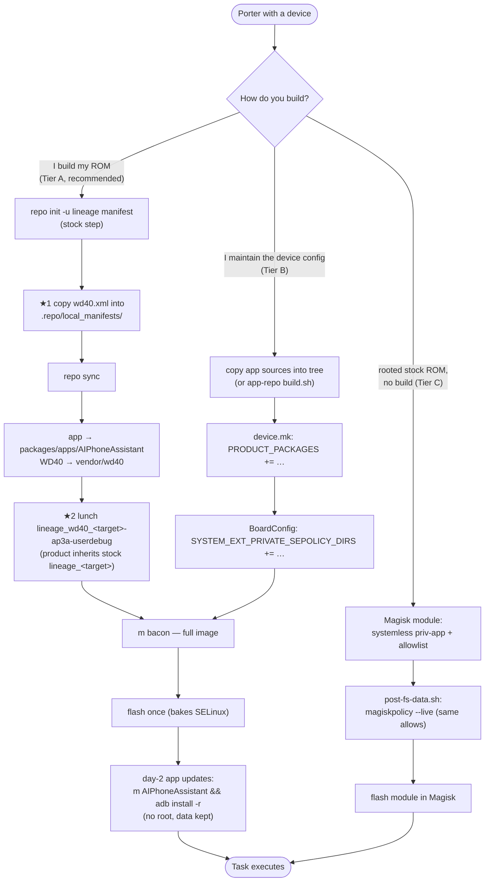
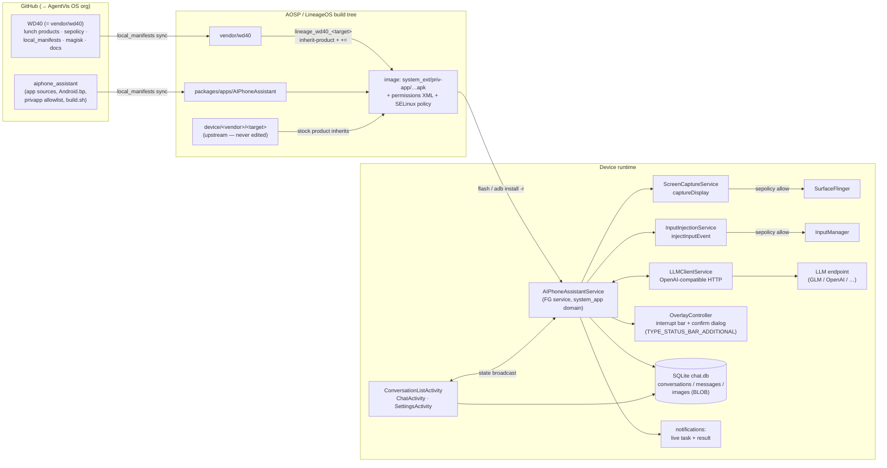
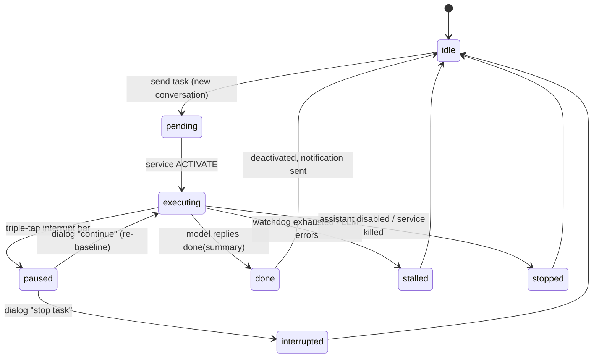

# Architecture & flow diagrams

Mermaid sources (rendered by GitHub); rendered PNGs live in `img/`.

## 1. Porting / build flow — where the integration plugs in

Two insertion points (marked ★) into the standard LineageOS workflow; the
three tiers below cover different audiences.

## 2. System architecture — repos, build tree, device runtime

## 3. Task lifecycle (one conversation per task)

